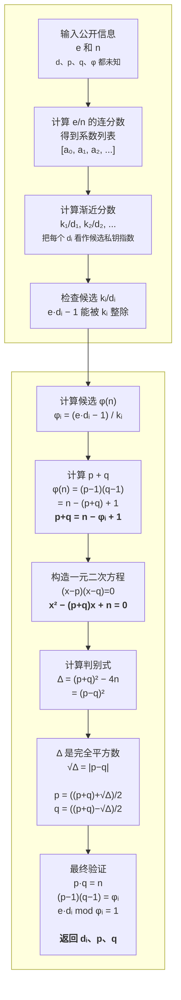

# RSA Wiener 攻击：8 分钟 Presentation 内容与讲解稿（中文版）

## 1. 整体安排

Presentation 共 7 页，包括封面，并在第 5 页切换到终端进行现场 Demo。

| 页码 | 内容 | 建议时间 |
|---:|---|---:|
| 1 | 封面 | 15 秒 |
| 2 | 小私钥指数漏洞与 Wiener 攻击思想 | 40 秒 |
| 3 | 普通 RSA 与弱 RSA 的参数构造 | 55 秒 |
| 4 | 我们实现的 Wiener 攻击流程 | 1 分 10 秒 |
| 5 | 2048-bit 现场 Demo | 2 分 30 秒 |
| 6 | 实验结果与分析 | 1 分 30 秒 |
| 7 | 自己编写的代码 | 20 秒 |
| | 合计 | 7 分 20 秒 |

剩余约 40 秒用于切换窗口、等待现场密钥生成或者处理短暂停顿。

---

## Slide 1：封面

### PPT 页面内容

标题：

> RSA Wiener Attack  
> Exploiting Small Private Exponents

副标题可写：

> Continued Fractions, Key Recovery and Experimental Evaluation

页面下方放组员姓名、课程名称和日期。不要在封面放公式、代码或实验图。

### 讲解稿

大家好，我们的项目研究 RSA 中的 Wiener 小私钥指数攻击。我们关注的问题是：
即使 RSA 模数已经达到 2048 bit，如果私钥指数 d 选择得过小，攻击者能否只使用
公开的 e 和 n 恢复私钥？

### 转场

首先看这个漏洞为什么会出现，以及 Wiener 攻击利用了什么数学关系。

---

## Slide 2：Small Private Exponent Vulnerability and Wiener Attack

### PPT 页面内容

页面左侧放 Wiener 攻击的核心关系：

\[
ed-k\varphi(n)=1
\]

\[
d<\frac{n^{1/4}}{3}
\]

\[
\frac{k}{d}\approx\frac{e}{n}
\]

页面右侧放连分数的标准形式和简写形式：

\[
x=a_0+\cfrac{1}{a_1+\cfrac{1}{a_2+\ddots+\cfrac{1}{a_n}}}
\]

\[
x=[a_0;a_1,a_2,\ldots,a_n]
\]

页面下方用一行表示渐近分数如何产生候选：

```text
e/n = [a₀; a₁, a₂, ...]
          ↓ 依次截断
k₀/d₀, k₁/d₁, k₂/d₂, ...
          ↓
候选 k/d 和候选私钥指数 d
```

在旁边放一句：

> 连分数把搜索所有 d，缩小为检查一组渐近分数候选。

### 讲解稿

这里简单回顾 Wiener 攻击。当 d 满足页面上的条件时，k/d 会非常接近 e/n。
具体来说，我们把 e/n 写成屏幕右侧的连分数形式，再从前往后依次截断，就会得到
下方这一组渐近分数；其中每个分母都可以作为候选私钥指数。

这些渐近分数会提供少量候选私钥指数，因此不需要从 1 开始枚举所有 d。

### 转场

为了测试这个漏洞，我们需要生成合法的普通 RSA 密钥，以及只在 d 的大小上故意
变弱的 RSA 密钥。

---

## Slide 3：Weak RSA Construction vs Normal RSA Construction

### PPT 页面内容

页面采用左右两列流程图。

#### 左侧：Normal RSA

```text
生成大小接近的素数 p、q
           ↓
n = p·q
φ(n) = (p−1)(q−1)
           ↓
选择常用公钥指数 e = 65537
           ↓
检查 gcd(e, φ(n)) = 1
           ↓
d = e⁻¹ mod φ(n)
           ↓
得到普通 RSA 密钥
```

#### 右侧：Wiener-weak RSA

```text
生成大小接近的素数 p、q
           ↓
n = p·q
φ(n) = (p−1)(q−1)
           ↓
T ≈ n^(1/4) / 3
           ↓
选择 d ≈ ratio · T
           ↓
寻找接近目标且满足 gcd(d, φ(n)) = 1 的奇数 d
           ↓
e = d⁻¹ mod φ(n)
           ↓
检查所有 RSA 参数关系
```

页面底部突出区别：

> 普通 RSA：先固定 e，再计算 d。  
> 弱 RSA：先故意选择很小的 d，再计算 e。

再放一句：

> 两组都是数学上有效的 RSA 密钥，实验中有意改变的主要参数是 d 的大小。

### 讲解稿

普通 RSA 和弱 RSA 的前半部分完全相同，都先生成大小接近的 p 和 q，再计算 n 和
phi(n)。

普通 RSA 使用常见的 e 等于 65537，然后计算它关于 phi(n) 的模逆得到 d。我们的
弱密钥生成流程则先计算 Wiener 阈值 T，再根据指定的 d/T 比例选择一个较小的 d。
由于 d 必须和 phi(n) 互素，程序会在目标值附近寻找满足条件的奇数，最后反过来
计算 e。

因此，弱密钥并不是随便伪造的一组数字。它仍满足 RSA 的全部参数关系，区别是 d
被有意放到了 Wiener 攻击适用的范围内。

### 转场

生成弱密钥后，攻击程序不会读取生成时保存的 p、q、d 或 phi，而只接收公开的
e 和 n。下面是我们实现的完整恢复流程。

---

## Slide 4：Our Wiener Attack Implementation

### PPT 页面内容

流程图只展示找到正确候选时的成功路径。PPT 中建议排成上下两行的蛇形结构，保证
每个公式都足够大。



流程图下方放一句小字：

> 如果任意检查失败，程序继续检查下一个渐近分数。

### 讲解稿

攻击函数的输入只有公开的 e 和 n。程序先计算 e/n 的连分数，再把每个渐近分数
看作一组候选 k 和 d。

对于满足页面整除条件的候选，我们可以计算出候选 phi(n)。然后利用 phi(n) 得到
p+q。因为同时知道 p 和 q 的乘积就是 n，所以可以构造页面中的一元二次方程。

如果判别式是完全平方数，就能得到整数 p 和 q。程序最后再精确验证这些值是否满足
RSA 参数关系；全部成立才返回 d、p 和 q，否则继续检查下一个候选。

### 转场

下面我们现场生成两组 2048-bit RSA 密钥，并用完全相同的攻击入口进行验证。

---

## Slide 5：Live Demo — 2048-bit Weak RSA vs Normal RSA

### PPT 页面内容

页面只保留四个 Demo 目标：

```text
1. 现场生成两组 2048-bit RSA 密钥
2. 攻击函数只使用公开的 e 和 n
3. 从弱密钥恢复 d、φ(n)、p 和 q，并完成解密
4. 对普通 RSA 运行完全相同的攻击
```

页面底部放运行命令：

```powershell
python -B scripts/demo.py
```

### Demo 操作和讲解稿

切换到项目根目录的终端，执行：

```powershell
python -B scripts/demo.py
```

运行后按下面顺序指出关键信息，不要逐行朗读所有输出。

#### 第一步：说明数据来源

讲解：

> 这两组密钥都是本次运行现场随机生成的，而且 n 都是实际的 2048 bit。第一组
> 故意使用较小的 d，第二组使用 e=65537 的普通参数生成方式。

#### 第二步：指出弱密钥条件

指向：

```text
d/T = 0.750000
d < n^(1/4)/3 = True
```

讲解：

> 弱密钥的 d 大约是 Wiener 阈值的 75%，所以位于本项目采用的经典边界内。
> 生成时保存的 d、p、q 和 phi 只用于最后验证，不会传入攻击函数。

#### 第三步：指出连分数与成功候选

指向连分数系数摘要和：

```text
successful candidate = No. ...
successful k
successful candidate d
```

讲解：

> 程序计算 e/n 的连分数，并依次检查渐近分数。这里显示的是最终成功候选的编号、
> k 和候选 d。我们不需要逐个读取所有连分数系数。

#### 第四步：指出恢复链条

依次指出：

```text
recovered phi
recovered p+q
discriminant
sqrt(discriminant)
recovered p
recovered q
recovered d
```

讲解：

> 这部分对应刚才的算法流程。程序先从候选 k 和 d 得到 phi，再得到 p+q，构造
> 一元二次方程并检查判别式，最后恢复 p 和 q。

#### 第五步：指出成功验证

指向：

```text
recovered phi == reference = True
recovered p*q == n = True
recovered d == reference = True
decryption successful = True
```

讲解：

> 恢复出的 phi、p、q 和 d 都与现场生成时保留的参考值一致，而且使用恢复出的 d
> 可以正确解密测试消息。

#### 第六步：普通 RSA 对照

指向：

```text
d/T = ...E+462
d < n^(1/4)/3 = False
wiener_attack returned None = True
```

讲解：

> 普通 RSA 同样使用 2048-bit 模数，但 d/T 大约在 10 的 462 次方数量级，远离
> Wiener 边界。调用完全相同的攻击函数后，本次返回 None。这不是完整的 RSA 安全
> 证明，但说明前面攻击成功依赖小 d 弱点，而不是因为所有 RSA 都能这样恢复。

### Demo 注意事项

- 不朗读 n、e、d、p、q、phi 的完整大整数。
- 不逐个解释连分数系数。
- 不解释每一个计时数据。
- 普通 RSA 很快返回 None，是因为 e=65537 时 e/n 的连分数通常较短；不要把更短
  的运行时间解释为普通 RSA 更容易攻击。

### 转场

一次现场运行只能说明当前样本。接下来通过多组随机密钥观察成功率和攻击耗时。

---

## Slide 6：Experimental Results

### PPT 页面内容

建议布局：

- 左侧约 60%：`wiener_success_vs_d_ratio.png`。
- 右上约 40%：`wiener_time_vs_modulus_bits.png`。
- 右下：E3 普通 RSA 与弱 RSA 对照表。

E3 表格：

| 2048-bit 密钥类型 | d/T 中位数 | 正确恢复 |
|---|---:|---:|
| Weak RSA | 0.75 | 30/30 |
| Normal RSA | 2.578×10^462 | 0/30 |

页面底部放三个结论：

1. Wiener 边界内的测试弱密钥全部被恢复。
2. 超过边界后攻击仍可能成功，但不再有经典定理保证。
3. 如果 d 仍然过小，仅增大 n 到 2048 bit不能消除该漏洞。

### 讲解稿

左侧实验固定 512-bit 模数并改变 d/T，每组运行 30 次。当 d/T 从 0.25 到 1.5
时，本轮实验全部成功。从 2.0 开始成功率总体下降，但边界外仍然存在成功样本。
这说明经典边界不是“超过以后立即失败”的绝对分界线，而是在相关假设成立时的
充分保证。

右上实验固定 d/T 为 0.75，只改变模数位数。256、512、1024 和 2048-bit 四组都
成功恢复 30 次。攻击耗时中位数从 0.179 毫秒增加到 6.425 毫秒。耗时随位数增加，
但 2048-bit 弱密钥仍然可以在毫秒级恢复，因为攻击利用的是过小的 d，而不是暴力
分解 n。

右下是 2048-bit 对照实验。弱密钥组的 d/T 中位数是 0.75，30 次全部恢复；普通
RSA 组的 d/T 中位数约为 2.578 乘以 10 的 462 次方，本轮 30 次都没有恢复。
这组对照表明，在 d 过小的情况下，仅使用更大的模数并不能避免本次攻击。

这些结果来自课程规模的随机实验。返回 None 只说明 Wiener 攻击没有在这些样本上
成功，不是对 RSA 所有攻击方式的完整安全证明。

### 转场

最后，我们列出本项目中声明为自己实现的核心函数。

---

## Slide 7：Self-Implemented Code

### PPT 页面内容

页面按功能分成四组。

#### RSA 参数构造

- `generate_normal_rsa()`
- `generate_weak_rsa()`
- `_nearest_odd_coprime()`

#### Wiener 边界

- `approximate_wiener_threshold()`
- `is_below_wiener_bound()`

#### 连分数

- `continued_fraction()`
- `convergents()`

#### 攻击与验证

- `wiener_attack()`

### 讲解稿

这里列出的是我们声明自己实现的核心代码，包括普通与弱 RSA 的参数生成流程、
Wiener 边界计算、连分数和渐近分数，以及完整的候选验证和攻击流程。谢谢。

---

## 2. 排练检查清单

- 总时长控制在 7 分 20 秒左右，不主动讲备用内容。
- 演示前确认处于 conda common 环境和项目根目录。
- 现场至少完整运行三次 `python -B scripts/demo.py`。
- PPT 中的 E1、E2 图片使用 `results/plots` 下的正式实验图。
- E3 表格使用 2048-bit、每组 30 次的正式结果。
- Demo 中的大整数是随机值，与 PPT 表格中的批量实验样本不同。
- 不把 Wiener 攻击返回 None 说成普通 RSA 的完整安全证明。
- 不把 Wiener 边界说成超过以后绝对攻击失败的分界线。
