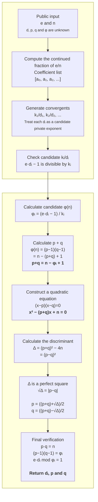

# RSA Wiener Attack: 8-Minute Presentation Content and Script (English)

## 1. Overall timing

The presentation contains seven slides including the title slide. Slide 5 is used as a
transition to the live terminal demonstration.

| Slide | Content | Suggested time |
|---:|---|---:|
| 1 | Title | 15 seconds |
| 2 | Small private exponent vulnerability and Wiener’s idea | 40 seconds |
| 3 | Normal RSA versus weak RSA key construction | 55 seconds |
| 4 | Our Wiener attack implementation | 1 minute 10 seconds |
| 5 | Live 2048-bit demonstration | 2 minutes 30 seconds |
| 6 | Experimental results and analysis | 1 minute 30 seconds |
| 7 | Self-implemented code | 20 seconds |
| | Total | 7 minutes 20 seconds |

The remaining 40 seconds provide a buffer for switching windows, generating the keys,
or handling a short pause.

---

## Slide 1: Title

### Content on the slide

Title:

> RSA Wiener Attack  
> Exploiting Small Private Exponents

Optional subtitle:

> Continued Fractions, Key Recovery and Experimental Evaluation

Place the team members, course name, and date at the bottom. Do not put equations,
source code, or experimental plots on this slide.

### Speaker script

Hello everyone. Our project studies Wiener’s small-private-exponent attack against
RSA. Our main question is: even when the RSA modulus is 2048 bits long, can an
attacker recover the private exponent using only the public values e and n if d is
chosen too small?

### Transition

We will first explain where this vulnerability comes from and which mathematical
relationship Wiener’s attack exploits.

---

## Slide 2: Small Private Exponent Vulnerability and Wiener Attack

### Content on the slide

Place the three core relationships on the left:

\[
ed-k\varphi(n)=1
\]

\[
d<\frac{n^{1/4}}{3}
\]

\[
\frac{k}{d}\approx\frac{e}{n}
\]

Place the standard and abbreviated continued-fraction forms on the right:

\[
x=a_0+\cfrac{1}{a_1+\cfrac{1}{a_2+\ddots+\cfrac{1}{a_n}}}
\]

\[
x=[a_0;a_1,a_2,\ldots,a_n]
\]

Use one short sequence at the bottom to show how convergents produce candidates:

```text
e/n = [a₀; a₁, a₂, ...]
          ↓ truncate successively
k₀/d₀, k₁/d₁, k₂/d₂, ...
          ↓
Candidate k/d and candidate private exponent d
```

Add this sentence beside the sequence:

> Continued fractions reduce a search over all d values to a small set of convergent candidates.

### Speaker script

Here is a short review of Wiener’s attack. When d satisfies the condition shown on the
slide, k over d becomes very close to e over n. More specifically, we write e over n
in the continued-fraction form shown on the right and truncate it successively. This
gives the convergents shown below, and each denominator becomes a candidate private
exponent.

These convergents provide a small set of candidate private exponents, so we do not
need to enumerate every d starting from one. This slide only shows where the candidates
come from; the full candidate-verification procedure appears in the later attack
flowchart.

### Transition

To evaluate this vulnerability, we generate both normal RSA keys and valid RSA keys
whose private exponent is intentionally small.

---

## Slide 3: Weak RSA Construction vs Normal RSA Construction

### Content on the slide

Use two side-by-side flowcharts.

#### Left: Normal RSA

```text
Generate similarly sized primes p and q
                 ↓
n = p·q
φ(n) = (p−1)(q−1)
                 ↓
Choose the common public exponent e = 65537
                 ↓
Check gcd(e, φ(n)) = 1
                 ↓
d = e⁻¹ mod φ(n)
                 ↓
Normal RSA key
```

#### Right: Wiener-weak RSA

```text
Generate similarly sized primes p and q
                 ↓
n = p·q
φ(n) = (p−1)(q−1)
                 ↓
T ≈ n^(1/4) / 3
                 ↓
Choose d ≈ ratio · T
                 ↓
Find a nearby odd d with gcd(d, φ(n)) = 1
                 ↓
e = d⁻¹ mod φ(n)
                 ↓
Verify all RSA parameter relations
```

Highlight the main difference:

> Normal RSA: fix e first, then calculate d.  
> Weak RSA: intentionally choose a small d first, then calculate e.

Add one sentence below the comparison:

> Both outputs are mathematically valid RSA keys; the intended experimental difference
> is the size of d.

### Speaker script

The first half of the two procedures is identical. Both generate similarly sized
primes p and q and then calculate n and phi of n.

Normal RSA uses the common public exponent 65537 and calculates its modular inverse
to obtain d. Our weak-key generator first calculates the approximate Wiener threshold
T and chooses d according to a requested d-over-T ratio. Because d must be coprime
with phi of n, the program searches near the target for a suitable odd value and then
calculates e as the modular inverse of d.

The weak key is therefore not an arbitrary collection of numbers. It still satisfies
all RSA parameter relationships. The intended weakness is that d has been placed
inside the range targeted by Wiener’s attack.

### Transition

After generating the weak key, the attack does not read p, q, d, or phi from the key
generator. It receives only the public values e and n. The next slide shows our full
recovery procedure.

---

## Slide 4: Our Wiener Attack Implementation

### Content on the slide

The flowchart shows only the successful path for the correct candidate. Arrange it as
a two-row snake layout in the final PowerPoint so that every equation remains large
enough to read.



Place this short note below the diagram:

> If any check fails, the algorithm continues with the next convergent.

### Speaker script

The attack receives only the public values e and n. It first calculates the continued
fraction of e over n and treats each convergent as a candidate k and d.

For a candidate that satisfies the divisibility check shown on the slide, we can
calculate a candidate phi of n. From phi, we obtain p plus q. Since the product of p
and q is already known to be n, we can construct the quadratic equation shown here.

If its discriminant is a perfect square, the equation gives integer values for p and
q. The program then verifies all RSA parameter relationships exactly. It returns d,
p, and q only when every check passes; otherwise, it continues with the next candidate.

### Transition

We will now generate two 2048-bit RSA keys live and test both keys through exactly the
same attack interface.

---

## Slide 5: Live Demo — 2048-bit Weak RSA vs Normal RSA

### Content on the slide

Keep only four demonstration goals on the slide:

```text
1. Generate two 2048-bit RSA keys live
2. Give the attack only the public e and n
3. Recover d, φ(n), p and q from the weak key, then decrypt
4. Run the identical attack against the normal key
```

Place the command at the bottom:

```powershell
python -B scripts/demo.py
```

### Demo procedure and speaker script

Switch to a terminal at the project root and run:

```powershell
python -B scripts/demo.py
```

Point out only the following results instead of reading every output line.

#### Step 1: Identify the data source

Say:

> Both keys were randomly generated during this run, and both moduli are actually
> 2048 bits long. The first key intentionally uses a small d, while the second key
> uses the normal construction with e equal to 65537.

#### Step 2: Show the weak-key condition

Point to:

```text
d/T = 0.750000
d < n^(1/4)/3 = True
```

Say:

> The weak key uses a d approximately 75 percent of the Wiener threshold, so it is
> inside the classical boundary used in our project. The generator keeps d, p, q,
> and phi only for final verification; these values are not passed to the attack.

#### Step 3: Show the continued fraction and successful candidate

Point to the coefficient summary and:

```text
successful candidate = No. ...
successful k
successful candidate d
```

Say:

> The program calculates the continued fraction of e over n and examines its
> convergents. These lines show the number of the successful candidate, its k, and
> its candidate d. We do not need to read every continued-fraction coefficient.

#### Step 4: Show the recovery chain

Point to these lines in order:

```text
recovered phi
recovered p+q
discriminant
sqrt(discriminant)
recovered p
recovered q
recovered d
```

Say:

> This output follows the algorithm shown on the previous slide. The program first
> obtains phi from the candidate k and d, calculates p plus q, constructs the
> quadratic equation, checks the discriminant, and finally recovers p and q.

#### Step 5: Show successful verification

Point to:

```text
recovered phi == reference = True
recovered p*q == n = True
recovered d == reference = True
decryption successful = True
```

Say:

> The recovered phi, p, q, and d all match the private reference values retained by
> the live generator. The recovered d also decrypts the test message correctly.

#### Step 6: Show the normal RSA control

Point to:

```text
d/T = ...E+462
d < n^(1/4)/3 = False
wiener_attack returned None = True
```

Say:

> The normal key also has a 2048-bit modulus, but its d over T is on the order of ten
> to the power of 462, far outside the Wiener boundary. The identical attack returns
> None in this run. This is not a complete proof of RSA security, but it demonstrates
> that the earlier recovery depended on the small-d weakness rather than applying to
> every RSA key.

### Demo reminders

- Do not read the complete large values of n, e, d, p, q, or phi.
- Do not explain every continued-fraction coefficient.
- Do not discuss every timing value.
- Normal RSA may return None more quickly because e equals 65537 and the continued
  fraction of e over n is usually short. Do not interpret the shorter runtime as
  meaning that normal RSA is easier to attack.

### Transition

A single live run demonstrates only one pair of keys. We therefore generated multiple
random keys to measure success rates and attack time.

---

## Slide 6: Experimental Results

### Content on the slide

Recommended layout:

- Left 60 percent: `wiener_success_vs_d_ratio.png`.
- Upper-right 40 percent: `wiener_time_vs_modulus_bits.png`.
- Lower-right: the E3 weak-versus-normal comparison table.

E3 table:

| 2048-bit key type | Median d/T | Correctly recovered |
|---|---:|---:|
| Weak RSA | 0.75 | 30/30 |
| Normal RSA | 2.578×10^462 | 0/30 |

Place these three findings at the bottom:

1. All tested weak keys inside the Wiener boundary were recovered.
2. Success remained possible beyond the boundary, but it was no longer guaranteed.
3. Increasing n to 2048 bits did not remove the vulnerability when d remained too small.

### Speaker script

The experiment on the left fixes the modulus size at 512 bits and changes d over T,
with 30 trials in each group. Every key was recovered in the groups from 0.25 through
1.5. Starting at 2.0, the overall success rate decreased, although some samples beyond
the boundary were still recovered. This shows that the classical boundary is not a
hard line where every attack immediately fails. It is a sufficient guarantee under
the relevant assumptions.

The upper-right experiment fixes d over T at 0.75 and changes the modulus size. All
30 keys were recovered in each of the 256-, 512-, 1024-, and 2048-bit groups. The
median attack time increased from 0.179 milliseconds to 6.425 milliseconds. The
runtime increased with the modulus size, but the 2048-bit weak keys were still
recovered in milliseconds because the attack exploits a small d rather than
brute-force factorization.

The lower-right table presents the 2048-bit control experiment. The weak group had a
median d over T of 0.75 and all 30 keys were recovered. The normal group had a median
d over T of approximately 2.578 times ten to the power of 462, and none of the 30 keys
were recovered. In this experiment, using a larger modulus did not prevent the attack
when d remained too small.

These are course-scale randomized experiments. Returning None only means that Wiener’s
attack did not succeed on these samples; it is not a complete security proof against
all possible attacks on RSA.

### Transition

Finally, we list the core functions that we declare as our own implementation.

---

## Slide 7: Self-Implemented Code

### Content on the slide

Group the functions by purpose.

#### RSA key construction

- `generate_normal_rsa()`
- `generate_weak_rsa()`
- `_nearest_odd_coprime()`

#### Wiener boundary

- `approximate_wiener_threshold()`
- `is_below_wiener_bound()`

#### Continued fractions

- `continued_fraction()`
- `convergents()`

#### Attack and verification

- `wiener_attack()`

### Speaker script

These are the core functions that we declare as our own implementation. They include
the normal and weak RSA parameter-generation workflows, the Wiener-bound calculations,
the continued-fraction and convergent algorithms, and the complete candidate-testing
and attack procedure. Thank you.

---

## 2. Rehearsal checklist

- Keep the presentation close to 7 minutes 20 seconds and do not present backup
  material unless asked.
- Confirm that the conda common environment is active and that the terminal is at the
  project root.
- Rehearse `python -B scripts/demo.py` from beginning to end at least three times.
- Use the formal E1 and E2 plots from `results/plots` in the presentation.
- Use the formal 2048-bit, 30-trial E3 results in the comparison table.
- The large values shown in the live demo are random and are different from the keys
  used to produce the batch experimental results.
- Do not describe a None result as a complete proof of normal RSA security.
- Do not describe the Wiener boundary as a line beyond which every attack must fail.
